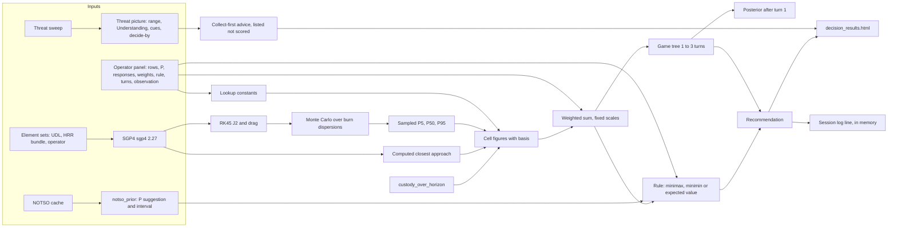

# 01. Architecture map: the decision-analysis engine as built

**Baseline:** commit `ddba577829b6de0a924d76c82077931cd2ba69f8`, version 0.24.2, Python 3.13.17, sgp4 2.27 (C++ accelerated), scipy 1.17.1, numpy 2.4.6. The pins in `requirements-runtime.txt` match the installed versions.
**Yardstick:** `evaluation/framework/decision-engine-evaluation-framework.md` (the owner's upload, copied byte-identical, sha256 `a0f1e18b…d3f99a`).
**Status:** Phase 1 checkpoint. Every entry is Fact (read in code at the line given) unless tagged otherwise. Behaviour is verified by probes in Phase 4, not here.

## 1. Where the engine lives

| Layer | Module | Lines | Role |
|:-|:-|:-|:-|
| Domain | `spectre/domain/decision.py` | 3,958 | Scenario, outcome matrix, scoring, the three decision rules, sampled and computed figures, custody, provenance hook |
| Domain | `spectre/domain/decision_tree.py` | 1,172 | Game tree of 1 to 3 turns |
| Domain | `spectre/domain/tree_selectors.py` | 292 | Decision rules over the tree, information sets |
| Domain | `spectre/domain/turn_update.py` | 233 | Likelihood model and posterior after turn 1 |
| Domain | `spectre/domain/threat_understanding.py` | 2,110 | Threat range, cues (value of information) and collect-first advice |
| Domain | `spectre/domain/decide_by.py` | n/a | Act-by time ("decide-by") |
| Domain | `spectre/domain/custody.py` | n/a | Custody status and its course over the horizon |
| Domain | `spectre/domain/notso_prior.py` | 481 | Suggested adversary probability from Notice to Space Operators (NOTSO) history, with a Poisson interval |
| Domain | `spectre/domain/decision_figures.py` | 425 | Time of closest approach (TCA) uncertainty; our burn's figures |
| Domain | `spectre/domain/provenance.py` | n/a | Input hashes, code version, figure basis |
| Physics | `spectre/astro/propagator.py` | 354 | SGP4 wrapper over `sgp4.api.Satrec` |
| Physics | `spectre/astro/elset_approach.py` | n/a | SGP4 closest approach for both orbits, no burn |
| Physics | `spectre/astro/monte_carlo.py` | 1,676 | Monte Carlo over RK45 (J2 and exponential drag); separation series |
| Physics | `spectre/astro/along_track.py` | n/a | Element-set position error by age |
| Web | `spectre/web/routes/decision.py` | 1,025 | Form parsing, weights, rule choice, evaluation call |
| Web | `spectre/web/decision_job.py` | 360 | Background evaluation job, session log line |
| Web | `spectre/web/decision_from_sweep.py` | 402 | Scenario built from the threat sweep |
| Web | `spectre/web/tree_view.py` | n/a | Tree view model |
| Web | `templates/partials/decision_panel.html`, `decision_results.html` | 404, 498 | Operator input and result display |

Entry point: `spectre/web/app.py:336` (`app = FastAPI(...)`), run by `spectre.web._entrypoint` (`Dockerfile:197`). The engine is reached only through `routes/decision.py:975` and `decision_job.py:196`, both calling `evaluate_tree`, which for one turn is `evaluate_scenario`.

## 2. Concept to implementation

### 2.1 Payoff matrix construction: exists

● **Adversary courses of action (COAs):** `AdversaryAction` (`decision.py:787-825`), typed by `ActionType` (`decision.py:208-212`): MANOEUVRE, SENSOR_RETASK, POSTURE_CHANGE, NO_ACTION. Each carries probability P (default 0.5, `decision.py:771`), a custody-gap fraction (default 0.7, `decision.py:775`) and an optional manoeuvre hypothesis (`AdversaryHypothesis`, `decision.py:626-770`). The operator enters the rows; a scenario opened from the sweep pre-fills them (`decision_from_sweep.py`).
● **No residual "other or unmodelled" row** and no mutual-exclusivity check: P is normalised by the sum of rows' P wherever it is read (`decision.py:3631-3644`; `tree_selectors.py:155-157`). [Fact]
● **Friendly responses:** `FriendlyResponse` (`decision.py:849-874`), with cost, reversibility, time to execute and an optional burn spec. "Do nothing" is expressible as a NO_ACTION response; it is not forced into the set. [Fact]
● **Cell derivation:** `_cell` (`decision.py:3459-3510`) picks, per row, a sampled cell (Monte Carlo), a computed cell (SGP4, or RK45 when burns or a tree are involved), a refused cell (a lookup with the refusal reason) or a lookup cell (`_lookup_figures`, `decision.py:2007-2043`, using per-type constants `_BASE_CA_KM`, `decision.py:1912-1917`). Custody is overlaid per row (`_custodial`, `decision.py:3527-3531`).
● Each figure carries a `FigureBasis` of LOOKUP, SAMPLED or COMPUTED (`provenance.py:55-75`), and the score's basis is fixed at LOOKUP (`_SCORING_RULE_KIND`, `decision.py:266`).

### 2.2 Multi-criteria weighted scoring: exists

● **Aggregation:** additive weighted sum, `_score` (`decision.py:2049-2069`). Higher is worse (a cost).
● **Criteria and scales:** custody gap over horizon (0 when held), closest approach inverted over a fixed 0 to 50,000 km scale (`_CA_NORMALISATION_KM`, `decision.py:1919`; `_norm_ca`, `decision.py:2044`), our delta-V over a fixed 0 to 0.1 km/s scale (`decision.py:1921`), time to execute over the horizon, reversibility inverted.
● **Normalisation is on fixed reference scales, not on the current set of alternatives.** [Fact] Framework 1b's rank-reversal mechanism (set-dependent normalisation) does not apply as described; a probe in Phase 4 will test it.
● **Weights:** defaults 0.35, 0.25, 0.20, 0.10, 0.10 (`decision.py:1465-1470`), editable on the panel (`routes/decision.py:773-777`), rescaled to sum to 1 (`_normalised_weights`, `routes/decision.py:589-594`). Each weight is checked only to lie in [0, 1] (`decision.py:1490-1491`).
● **No weight-elicitation record** in the repository; the weights are described as uncited (`decision.py:264-265`, backlog SPC-151). [Fact for the code comment; the absence of an elicitation record elsewhere is not visible in this repository]
● **No weight-sensitivity or weight-stability display.** Sensitivity exists only for P, under expected value (`interval_pick`, `joint_pick`, `decision.py:3712-3752`). [Fact]

### 2.3 Decision rules: exist

● `SelectorStrategy` (`decision.py:215-222`): MINIMAX, EXPECTED_VALUE, MINIMIN.
● `find_robust_response` (`decision.py:3584-3628`): minimax takes, per response, the maximum composite score over rows, then the minimum; minimin takes the minimum of minima; expected value delegates to `_expected_value_pick` (`decision.py:3631-3644`). Ties go to the first response (`min` over indices).
● **Orientation:** scores are costs, so minimax (minimise the worst cost) is the cautious rule and minimin (minimise the best cost) the optimistic one. A code comment records an earlier mislabelling fixed under audit F-S05-01 (`decision.py:217-219`). [Fact; correctness to be probed]
● **Who selects:** the operator, per evaluation, through a select on the panel (`decision_panel.html:293-296`), parsed by `_strategy` with a fallback to minimax (`routes/decision.py:581-586`). The rule can be changed and the scenario re-evaluated after a result is seen. [Fact]
● **Results under other rules:** only the chosen rule's pick is the recommendation. Under expected value, when the probability is judged unearned, the result also names minimax's pick (`decision.py:1704-1720`). No side-by-side display of all three rules was found. [Fact for what was found; to be confirmed by probe and template read in Phase 2]
● **No minimax regret, no mixed strategies, no Hurwicz, no info-gap.** [Fact: none of these appear in `decision.py` or `tree_selectors.py`]

### 2.4 Game tree: exists

● **Depth:** 1 to 3 turns (`MAX_TURNS`, `decision.py:1498`). Turn 1 is the outcome matrix itself; later turns start from the states turn 1 leaves (`decision_tree.py:1-22`).
● **Branching:** full enumeration, bounded by `MAX_TREE_BRANCHES = 1,000` (`decision_tree.py:121`) and the sample-hour cost cap; refused before running if over (`refused_before_run`, `decision_tree.py:533`). **No pruning** (no alpha-beta or heuristic cut found). [Fact]
● **Leaf valuation:** each path's one-turn weighted sum on its path figures (smallest closest approach along it, our delta-V summed, custody with every red burn), basis LOOKUP (`decision_tree.py:9-14`, `path_figures`, `decision_tree.py:623`).
● **Adversary model:** red is not an optimiser. Under minimax red's moves are the worst case; under expected value they are weighted by the operator's P each turn; under minimin the best case (`_Selector._combine`, `tree_selectors.py:184-193`). No backward induction of a rational red. [Fact]
● **Information sets:** our later picks may depend only on what the custody rule shows (`_Selector._take`, `tree_selectors.py:167-182`).
● **Horizon:** stated in the result (the span searched; D3 equal turns).

### 2.5 Bayesian updating: exists, narrow

● **Prior:** the rows' P as entered or as an applied NOTSO suggestion (`notso_prior.py`, Poisson interval `poisson_interval`, `notso_prior.py:185`).
● **Likelihood:** deterministic 0 or 1 from the custody rule: custody lost at a burn shows a burn; held shows no burn; otherwise nothing (`turn_update.py:1-17`, `likelihood`, `turn_update.py:123`).
● **Posterior:** P restricted to the rows consistent with the one observation the operator states for turn 1, renormalised (`_posterior`, `turn_update.py:190-212`). One observation only; red's later moves are weighted by P as entered.
● **Independence and repeated observations:** only one observation enters, so repeated correlated observations cannot be double-counted by construction. [Fact; framework 1e's correlated-sensor concern is outside this engine's scope as built]
● **Numerics:** a ratio of sums of at most 5 probabilities; no log-space handling and no sequence long enough to underflow. [Inference from the single-observation design]

### 2.6 Value of information and collect first: exists, not decision-theoretic VOI

● **Cue value** is band steps of the Threat range a collection would remove, on a benign and a hostile hypothetical outcome, divided by hours to collect (`_cue`, `threat_understanding.py:1909-1922`; `Cue.steps_per_hour`, `threat_understanding.py:1814-1816`).
● **No probability over outcomes, no expected value of perfect information (EVPI) or of sample information (EVSI).** [Fact] The measure is a deterministic range-narrowing bound, not an expectation. Framework 1f's EVPI and EVSI tests do not apply as written; Phase 3 assesses what does.
● **Decision relevance:** a cue counts only if one outcome takes the range off the action line (`_decides`, `threat_understanding.py:1975-1979`); the action line is `Band.HIGH`, "tuned, not sourced" (`threat_understanding.py:1943-1945`).
● **Timeliness:** a cue counts only if it lands by decide-by (`landing_cues`, `threat_understanding.py:1981-1994`). No continuous delay cost; the deadline is a hard cut-off.
● **Act-by time:** decide-by is the earliest fastest credible arrival minus the response time (`decide_by.py:117-148`), with a 12 h default response time, "Claude's choice, not a ruling" (`decide_by.py:47`, `decide_by.py:10-16`).
● **Engine side:** collections are listed beside the ranking, never scored (`decision.py:1420-1431`, `decision.py:1636-1645`).

### 2.7 Physics inputs

● **SGP4:** `sgp4` 2.27, `Satrec.twoline2rv` (`propagator.py:112`), default gravity model (WGS-72 in that library), output frame True Equator Mean Equinox (TEME). An SGP4 error code raises (`propagator.py:119-125`). Verification vectors `SGP4-VER.TLE` and `tcppver.out` are installed with the library (site-packages `sgp4/`), so probe 12 needs no network.
● **Computed closest approach:** both orbits on SGP4 with no burn, sampled every 60 s and refined to 0.01 s (`elset_approach.py:103-123`).
● **RK45:** `solve_ivp` with `rtol 1e-8`, `atol 1e-10` (`monte_carlo.py:516-517`, calls at `monte_carlo.py:585-592` and `1358-1365`); force model two-body, J2 and exponential drag only (`_j2_drag_ode`, `monte_carlo.py:357-395`); no third bodies, no solar radiation pressure, no higher geopotential. Started from SGP4 states.
● **Monte Carlo sampling:** each sample perturbs the burn's delta-V magnitude, pointing, timing and B* by archetype sigmas (`monte_carlo.py:124-210`, defaults `monte_carlo.py:244-253`: 500 samples, seed 42). **Initial-state (element-set) error is not sampled**; there is no covariance input. [Fact: `decision.py:1875` says "element-set error is not in it"]
● **Convergence:** a 95 % bootstrap half-width of P5, P50 and P95 within 1 km, or 5 % of P5 (`monte_carlo.py:601-651`); fewer than 50 samples are refused (`decision.py:2262-2264`).
● **Collision probability (Pc):** **not computed anywhere in the engine.** The only Pc is UDL's filed figure, displayed as filed (`spectre/web/udl_conjunction.py:1-20`). Payoffs use miss distance (P5 where sampled). [Fact] Framework 1g and probe 11's Pc assumptions do not apply as written; probe 11 is recast to the P5 miss estimate.
● **Element-set age error model:** 1 km at epoch plus 2 km a day in LEO, 2 km plus 1 km a day at GEO (`along_track.py:28-36`), used for TCA uncertainty (`decision_figures.py:36-41`) and staleness. Whether it reaches the miss distance or the score is a Phase 3 question.
● **Labelled lookups:** per-action-type closest approach, 0.4 of the horizon, a rule-of-thumb custody and cost × 0.05 delta-V for unbound scenarios (`decision.py:1912-1921`, `2007-2043`), each tagged LOOKUP.

### 2.8 Uncertainty flow to the display

● Sampled cells show P5 to P95 with median and half-width (`decision.py:1156`), a cell caveat (`decision.py:2182`), score percentiles and spread (`decision.py:1165-1172`); a per-row uncertainty line (`_row_uncertainty`, `decision.py:1882-1900`); TCA ± from the element-set model.
● A computed SGP4 cell is one figure with "no spread; element-set error is not in it" (`decision.py:1875`).
● Lookup cells say "a fixed figure, with no distribution" (`decision.py:2214`).
● P intervals reach the pick under expected value only (`decision.py:3801-3816`).
● **No propagation of weight uncertainty, and no probability that each response ranks first.** [Fact]

### 2.9 Operator interface, explanation and records

● **Display:** `decision_results.html` shows the recommendation (`:146-152`), the matrix with each figure's basis in a `data-basis` attribute and title (`:240-244`), per-row custody (`:213-214`), interval lines (`:156-159`), collect-first advice and rows (`:57-66`), a per-adversary ranking (`:468-474`). Composite scores are coloured green below 0.25, amber below 0.50, red otherwise (`:231-236`). [Fact]
● **Provenance:** `ScenarioResult.provenance` holds the code version, calibration source and SHA-256 hashes of the scenario, bindings, hypotheses and priors (`decision.py:3939-3942`, `provenance.py:37-52`).
● **Records:** the result is held in the in-memory session (`decision_job.py:240-248`); a one-line entry goes to the session log, a bounded deque (`planning_state.py:68`), and to the Python logger. **No durable decision record and no record of the operator's decision.** The only database tables are users and training (`web/models.py:51`, `training/models.py:38-128`). [Fact]

### 2.10 Hard constraints, envelope and input validation

● **Vetoes or hard constraints (legal, rules of engagement, safety thresholds): absent.** No code path removes a response before aggregation. [Fact: no match for veto, constraint or rules of engagement in `spectre/`]
● **Envelope checks present:** horizon finite and positive (`decision.py:1486-1489`); weights in [0, 1]; turns 1 to 3; element-set freshness against its regime limit (`decision.py:1245-1330`); refusals before sampling for too few samples, stale or unknown-age orbits, a burn past the earned span, an element set newer than the burn, no propagable state, a start more than 10 km or 0.1 km/s from the bound red track (`decision.py:2109-2116`, `2262-2347`); failed or unconverged series after (`decision.py:2328-2347`); re-entry floor (`monte_carlo.py:1342-1346`); cost cap and wall-time budget (`decision.py:2090-2106`, `2562-2617`).
● **Not found:** an explicit operating design domain statement, and a check for the deep-space (SDP4) branch or a decayed object before evaluation. To be probed (probe 14).

## 3. Data flow

## 4. Could not locate, or absent

● Hard constraints and vetoes: absent.
● Durable decision record and the operator's own decision: absent.
● Weight elicitation record: absent from the repository; may exist elsewhere (not visible).
● Hazard log, safety-related determination, threat model document for the engine, JSP 936 ethical risk assessment, model card: not found in `docs/` or `audit/`; to be searched fully in Phase 2 before any is called absent.
● Collision probability: not computed (framework assumption does not hold).
● EVPI or EVSI: not computed (framework assumption does not hold).
● Element-set error in sampled or computed miss distances: not sampled; the age model reaches TCA uncertainty only, to be confirmed in Phase 3.
